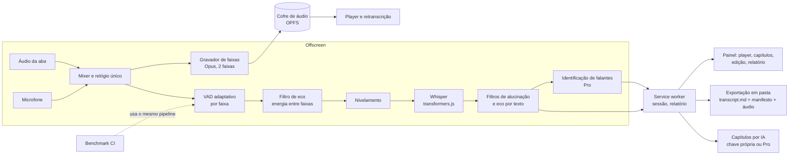

# TDD - Escribanote 3.x: áudio guardado, qualidade do Whisper e recursos aprendidos com o omarchy-meeting-recorder

| Campo            | Valor                                                                                   |
| ---------------- | --------------------------------------------------------------------------------------- |
| Tech Lead        | Thiago Meneses                                                                          |
| Time             | Thiago Meneses (produto e código), Claude Code (implementação assistida)                |
| Épico            | ClickUp, espaço Escribanote, lista "01" (a criar a partir deste documento)              |
| Referências      | github.com/jankeesvw/omarchy-meeting-recorder · github.com/illegalstudio/omarchy-call-recorder |
| Status           | Fases 1–6 entregues (3.0.0–3.5.0); pendências listadas em "Situação"                                                                                   |
| Criado           | 2026-10-26                                                                              |
| Última atualização | 2026-10-26 (fim do dia)                                                               |

## Contexto

O Escribanote é uma extensão para Chrome e Edge que transcreve reuniões do Google Meet, Teams, Zoom e Slack. A fonte principal são as legendas da própria plataforma, lidas pelo canal de dados e pela tela. Como complemento, o modo "alta precisão" roda o Whisper localmente (transformers.js com WebGPU ou WASM) sobre o áudio da aba e, opcionalmente, do microfone; o plano Pro acrescenta identificação de falantes pela voz (pyannote e WeSpeaker, também locais). A transcrição, as notas, os destaques e a ata ficam no computador, com backup automático em arquivos e sincronização opcional pela conta Pro. O áudio nunca é gravado.

Os dois projetos estudados atacam o mesmo problema por outro caminho. O omarchy-meeting-recorder (Rust, GTK, whisper.cpp, Linux) grava o microfone e a saída do computador em duas faixas separadas, transcreve cada faixa sozinha e usa a faixa de origem para saber de que lado veio cada fala. Em cima disso constrói reprodução com clique no horário, retranscrição, importação de arquivos, capítulos gerados por um agente de IA, ações automáticas por script e um benchmark com áudios sintéticos que roda no CI e bloqueia regressões. O omarchy-call-recorder (Python, GStreamer) é só um gravador, mas resolve bem a parte difícil da captura: linha do tempo única entre as duas fontes, silêncio inserido quando uma fonte para, correção de deriva de relógio, acompanhamento da troca de fone de ouvido no meio da chamada e um relatório de sessão em JSON com tudo o que aconteceu.

Este documento registra o que vale trazer para o Escribanote, o que não se aplica a uma extensão de navegador e em que ordem fazer. As decisões já tomadas com o dono do produto: o áudio passa a poder ser guardado, como opção desligada por padrão; e as melhorias de qualidade do Whisper andam em paralelo com os recursos de produto.

**Domínio**: transcrição de reuniões, processamento de áudio local, assistente de IA para atas.

**Partes interessadas**: usuários da extensão (equipes jurídicas, de tecnologia e de inovação em órgãos públicos e empresas), assinantes do Pro, o dono do produto.

## Definição do Problema e Motivação

### Problemas que estamos resolvendo

- **O áudio é descartado.** Sem áudio, não dá para ouvir um trecho duvidoso, transcrever de novo com um modelo melhor ou em outro idioma, nem importar uma gravação feita fora do navegador. Quando a legenda do Meet falha (sala com uma pessoa só, idioma errado, "legenda instantânea indisponível"), o usuário fica só com o que o Whisper produziu naquela hora.
  - Impacto: trechos perdidos não têm recuperação; retrabalho manual na ata.
- **O microfone capta o que sai da caixa de som.** Com alto-falantes, a voz dos outros entra pelo microfone e vira fala "sua" duplicada. Hoje dependemos só do cancelamento de eco do navegador.
  - Impacto: falas atribuídas à pessoa errada e texto repetido nas reuniões sem fone de ouvido.
- **Não há medida objetiva de qualidade.** O único teste de áudio é um trecho de fala embutido. Mudanças no segmentador, nos filtros de alucinação ou no modelo não têm como ser comparadas, e regressões só aparecem com o usuário.
  - Impacto: cada ajuste de limiar é um palpite; já aconteceu de uma mudança melhorar um caso e piorar outro sem ninguém perceber.
- **Reuniões longas são difíceis de navegar.** A versão 2.19.0 trouxe parágrafos e horários dentro dos blocos, mas uma reunião de uma hora continua sem um sumário por assunto.
  - Impacto: a pessoa rola a transcrição inteira para achar a parte que interessa.
- **Correções manuais são limitadas.** Dá para renomear e mesclar falantes, mas não para corrigir o texto de uma fala, mover uma fala para outro falante ou apagar uma linha errada, com desfazer.
  - Impacto: erros pequenos vão para a ata ou obrigam a editar fora da extensão.
- **Pouca visibilidade do que aconteceu na captura.** Quando a alta precisão produz pouco texto, não há registro de trocas de dispositivo, pausas, trechos descartados ou falhas do modelo.
  - Impacto: diagnóstico depende de reproduzir o problema com o desenvolvedor.

### Por que agora?

- A 2.17.x mostrou que as legendas do Meet falham em situações reais e que o caminho pelo áudio é o plano B obrigatório; vale a pena fortalecê-lo.
- A 2.19.0 já colocou horário por parágrafo na interface; o passo natural é o horário levar ao som.
- Os dois projetos estudados mostram soluções prontas e testadas para a parte mais arriscada (eco, alinhamento das faixas, benchmark), o que reduz o custo de descoberta.

### Impacto de não resolver

- **Negócio**: a alta precisão e a identificação de falantes são argumentos do Pro; sem áudio guardado e sem filtro de eco, ficam atrás de gravadores nativos.
- **Técnico**: cada ajuste de qualidade continua sem rede de proteção; o código do segmentador acumula limiares sem justificativa registrada.
- **Usuários**: atas com falas trocadas ou faltando e nenhuma forma de conferir o que foi dito.

## Escopo

### ✅ Dentro do escopo (3.0 a 3.3)

- Gravação opcional do áudio em duas faixas (aba e microfone), guardada no computador, com limite de espaço, retenção e apagamento por reunião.
- Reprodução com clique no horário do bloco ou do parágrafo e destaque da fala em andamento.
- Transcrever de novo (outro modelo, outro idioma, com ou sem identificação de falantes) a partir do áudio guardado.
- Importar um arquivo de áudio ou vídeo e transcrevê-lo como uma reunião.
- Filtro de eco do microfone em três camadas: comparação de energia entre faixas, voz-eco pela identificação de falantes e trigramas de texto repetido.
- Detecção de fala adaptativa por faixa, nivelamento de volume por faixa e filtros de alucinação por nível de áudio, marcadores de ruído e frases prontas.
- Horário por palavra quando o modelo permitir; senão, por segmento, como hoje.
- Benchmark com áudios sintéticos em pt-BR, verdade de referência, métricas e limiares por caso, rodando no CI do repositório.
- Capítulos gerados por IA (chave própria ou crédito Pro), mostrados na linha do tempo, na ata e nas exportações.
- Edição manual de falas: corrigir texto, mover para outro falante, apagar, dividir, com desfazer.
- Relatório de sessão por reunião: dispositivos, trocas, pausas, trechos descartados, modelo e tempos.
- Acompanhamento de troca de microfone durante a chamada e silêncio inserido para manter as faixas alinhadas.
- Exportação automática opcional de cada reunião como pasta (transcrição em Markdown, manifesto JSON e, se houver, áudio) na pasta de backup já escolhida pelo usuário.

### ❌ Fora do escopo

- Gravar vídeo ou webcam.
- Capturar a saída de áudio do sistema inteiro (só a aba da reunião e o microfone; o gravador do computador continua como está).
- Executar scripts do usuário a partir da extensão (o equivalente das "actions" fica resolvido pela exportação em pasta, que scripts externos podem observar).
- Trocar o motor Whisper (transformers.js continua).
- Diarização com o modelo Nemotron (o par pyannote e WeSpeaker continua; o benchmark dirá se vale trocar).
- Enviar áudio para a nuvem, inclusive para a conta Pro.

### 🔮 Considerações futuras

- Sincronizar o áudio guardado com a conta Pro, criptografado, se houver demanda.
- Usar as faixas separadas para treinar a identificação de falantes por usuário.
- Modelos Whisper ajustados para pt-BR, se o benchmark mostrar ganho.

## Solução Técnica

### Visão geral da arquitetura

O desenho mantém a arquitetura atual (service worker, documento offscreen com o pipeline de áudio, painel lateral e widget) e acrescenta três componentes: um **cofre de áudio** no armazenamento privado da extensão (Origin Private File System), um **gravador de faixas** dentro do documento offscreen que escreve nesse cofre em paralelo ao Whisper, e um **relatório de sessão** alimentado por todos os componentes. O pipeline do Whisper ganha etapas novas antes e depois do modelo. O benchmark é um projeto separado dentro do repositório que exercita o mesmo pipeline com arquivos em vez de microfone.

**Componentes**

- **Mixer e relógio único**: já existe (um AudioContext recebe as duas fontes). Passa a registrar lacunas de cada fonte e a inserir silêncio para manter as faixas alinhadas, como o audiorate do call-recorder faz com tolerância de 1 ms.
- **Gravador de faixas**: codifica cada fonte em Opus com a API WebCodecs ou MediaRecorder, em pedaços de poucos segundos, escrevendo direto no cofre. Grava apenas quando o usuário ligou a opção e a captura de áudio está ativa (alta precisão ou gravador). Um arquivo por faixa por reunião, mais um índice de pedaços para recuperação se o navegador fechar no meio.
- **Cofre de áudio**: pasta por reunião no OPFS. Guarda as faixas, o índice e o tamanho. Aplica o limite global de espaço (padrão 2 GB) e a retenção (padrão 30 dias), apagando primeiro as reuniões mais antigas sem marcação "manter". O usuário pode apagar o áudio de uma reunião sem apagar a transcrição.
- **VAD adaptativo por faixa**: substitui o piso único atual por um limiar por fonte. Microfone com margem proporcional à diferença entre fala e ruído, limitada entre 3 e 12 dB; aba com barra fixa de quatro vezes o piso. Os quadros ativos das duas faixas são unidos, para que som contínuo de um lado não esconda fala do outro.
- **Filtro de eco**: (1) um quadro do microfone só conta como fala própria se sua energia for ao menos metade da maior energia da aba nos quadros vizinhos; corridas menores que três quadros são descartadas; (2) com identificação de falantes, uma voz do microfone cuja fala coincide 60% ou mais com áudio da aba é tratada como eco, salvo quando não há outra voz com menos de 40%; (3) uma fala do microfone é descartada quando metade ou mais dos seus trigramas de palavras aparece em falas da aba a até dois segundos de distância.
- **Nivelamento**: cada faixa é normalizada para a mesma intensidade de fala antes do modelo, medida sobre os quadros com fala, nunca sobre o silêncio.
- **Filtros de alucinação**: além da lista de frases e da repetição em loop que já existem, descartar trechos com energia média abaixo de um piso, texto só com marcadores entre colchetes, parênteses ou asteriscos, e frases prontas só quando o trecho inteiro é a frase e o áudio está baixo. A probabilidade de "sem fala" do modelo entra como critério se o motor a expuser.
- **Horário por palavra**: pedir ao transformers.js os horários por palavra nos modelos que trazem as cabeças de alinhamento; aplicar piso de 250 ms por palavra. Onde não houver, manter o horário por segmento. O horário do parágrafo e do bloco passa a usar a primeira palavra.
- **Capítulos por IA**: para reuniões com três minutos ou mais, um pedido ao modelo com a transcrição em uma linha por fala pede de 2 a 12 capítulos, um a cada 5 a 10 minutos, com título de 2 a 6 palavras no idioma da reunião, começando sempre no horário de uma fala existente. A resposta é validada, ajustada para a fala mais próxima, deduplicada e limitada a 20 itens. Gasta um crédito Pro quando não há chave própria, com a mesma regra da ata.
- **Edição manual**: operações sobre uma fala (texto, falante, apagar, dividir) gravadas como uma pilha de alterações reversíveis na própria reunião, por cima das correções da IA, que continuam visíveis como "original".
- **Relatório de sessão**: documento JSON por reunião com eventos datados: dispositivos de entrada e trocas, pausas e retomadas, modelo e dispositivo de execução, trechos descartados por filtro e motivo, lacunas e silêncio inserido por faixa, tempos de carga e de transcrição, erros. Alimentado pelo offscreen e pelo service worker; mostrado em uma aba "Diagnóstico" da reunião e exportável.
- **Troca de microfone**: ouvir o evento de mudança de dispositivos; quando a faixa do microfone termina ou o padrão muda, readquirir o microfone e registrar a lacuna com silêncio.
- **Exportação em pasta**: para quem já escolheu uma pasta de backup, gravar também uma pasta por reunião com nome `AAAA-MM-DD HHMM Título`, contendo `transcricao.md` (mesmo formato da exportação Markdown, com capítulos), `reuniao.json` (manifesto: título, início, duração, plataforma, idioma, falantes, modelo, capítulos, caminhos do áudio) e as faixas de áudio quando existirem. Scripts externos podem observar essa pasta.
- **Importar arquivo**: arrastar um arquivo de áudio ou vídeo para o painel; o navegador decodifica, o pipeline transcreve com identificação de falantes (com número de falantes automático ou informado), e nasce uma reunião com a origem "importado".

### Fluxo de dados

1. O usuário inicia a alta precisão (ou o gravador). O offscreen captura a aba e o microfone no mesmo relógio.
2. Se a gravação de áudio está ligada, o gravador de faixas começa a escrever pedaços Opus no cofre e registra o início no relatório.
3. O VAD por faixa marca quadros de fala; o filtro de eco por energia decide quais quadros do microfone são fala própria.
4. Os trechos são nivelados e vão ao Whisper; o resultado passa pelos filtros de alucinação e pelo filtro de eco por texto.
5. Com identificação de falantes, o trecho é dividido por voz e o eco por voz é removido.
6. O service worker recebe os segmentos (com horário por palavra quando houver), aplica o vocabulário, grava na sessão e atualiza o painel e o widget.
7. Ao encerrar, o gravador fecha as faixas, o cofre calcula o espaço, o relatório é fechado e, se a exportação em pasta estiver ligada, a pasta da reunião é escrita.
8. Depois do encerramento, os capítulos são gerados em segundo plano, como a ata, e aparecem no painel.
9. Clicar no horário de um parágrafo abre o player sobre as faixas do cofre e posiciona o som; "transcrever de novo" reenvia as faixas ao pipeline como se fossem uma importação.

### Contratos internos (mensagens)

| Mensagem                  | Direção                 | Finalidade                                                               |
| ------------------------- | ----------------------- | ------------------------------------------------------------------------ |
| `audio-keep`              | painel → service worker | Liga ou desliga a gravação para a próxima reunião e informa limites      |
| `audio-get`               | painel → service worker | Obtém as faixas de uma reunião para o player                             |
| `audio-delete`            | painel → service worker | Apaga o áudio de uma reunião mantendo a transcrição                      |
| `retranscribe`            | painel → service worker | Reprocessa as faixas com modelo, idioma e falantes informados            |
| `import-audio`            | painel → service worker | Cria uma reunião a partir de um arquivo                                  |
| `chapters-generate`       | painel → service worker | Pede capítulos por IA                                                    |
| `edit-entry`              | painel → service worker | Aplica uma edição manual (texto, falante, apagar, dividir) com desfazer  |
| `session-report`          | offscreen → service worker | Acrescenta eventos ao relatório da reunião                            |

### Dados

**Reunião** (campos novos sobre o registro atual):

- `audio`: `{ tracks: ["tab", "mic"], bytes, codec, sampleRate, keep: boolean, deletedAt }`
- `chapters`: lista de `{ startAt, title }` e `chaptersBy` (modelo)
- `edits`: pilha de `{ id, at, kind, entryId, before, after }`
- `words`: por segmento do Whisper, lista opcional de `{ w, start, end }`
- `report`: lista de eventos `{ at, kind, detail }` e totais por faixa `{ in, gaps, silenceInserted }`
- `origin`: `"meeting" | "recorder" | "import"`

**Cofre de áudio (OPFS)**: `audio/<idReuniao>/tab.opus`, `mic.opus`, `index.json` (pedaços gravados, duração, sequência). Um `audio/quota.json` com o total usado e a última limpeza.

**Manifesto exportado (`reuniao.json`)**: versão do esquema, título, início, duração, plataforma, idioma, falantes com nomes, modelo, capítulos, arquivos de áudio, aplicativo e versão. Compatível em espírito com o `.meeting-recorder` do projeto estudado, sem pretender o mesmo formato.

**Ajustes novos**: `audioKeep` (desligado), `audioQuotaMb` (2048), `audioRetentionDays` (30), `chaptersAuto` (desligado), `folderExport` (desligado), `echoFilter` (ligado).

**Migração**: nenhuma reunião existente muda; os campos novos são opcionais e os leitores tratam ausência como vazio. O backup em arquivos e a sincronização Pro ignoram o áudio.

## Benchmark de qualidade

Um diretório `bench/` com casos em pt-BR gerados por vozes sintéticas (piper ou equivalente), confirmados no repositório para o CI não precisar gerá-los. Cada caso tem as duas faixas em Opus e um `verdade.json` com cada linha: falante, lado (você ou outros), início, fim e palavras. Casos iniciais:

| Caso                 | O que cobre                                                     |
| -------------------- | --------------------------------------------------------------- |
| fone-de-ouvido       | Chamada limpa, duas pessoas                                     |
| caixa-de-som         | A voz dos outros vaza para o microfone (eco)                    |
| duas-pessoas-no-mic  | Duas vozes do lado do usuário                                   |
| musica-de-fundo      | Som contínuo na aba sem fala                                    |
| importado-misto      | Um arquivo só, três falantes                                    |
| silencio             | Nenhuma fala; deve produzir zero linhas                         |
| mic-ruidoso          | Ruído constante no microfone                                    |
| termos-tecnicos      | Termos jurídicos, de tecnologia e em inglês, com vocabulário    |

Métricas por caso: palavras encontradas perto do momento certo, lado correto, pessoa correta, vazamento, linhas em silêncio, vozes distinguidas, tempo. Um `limiares.json` define o mínimo por caso, alguns pontos abaixo do obtido com o modelo pequeno, e o CI falha quando qualquer caso cai abaixo. Toda alteração que melhora a qualidade sobe o limiar no mesmo commit. O benchmark roda com o pipeline real em um navegador sem interface, no mesmo arranjo dos testes de ponta a ponta já existentes.

## Riscos

| Risco | Impacto | Probabilidade | Mitigação |
| ----- | ------- | ------------- | --------- |
| Guardar áudio contraria a promessa "nada é gravado" e assusta usuários | Alto | Média | Desligado por padrão; aviso claro ao ligar; indicador visível no widget enquanto grava; apagar por reunião; retenção automática; nunca sai do computador |
| Espaço em disco estoura ou o navegador limpa o OPFS | Alto | Média | Cota com limpeza das mais antigas; pedir armazenamento persistente ao navegador; a transcrição nunca depende do áudio existir |
| Filtro de eco corta a fala do usuário em ambientes ruidosos | Alto | Média | Margens adaptativas, descarte só com concordância de duas camadas, caso "mic-ruidoso" no benchmark, opção para desligar o filtro |
| Horário por palavra indisponível ou impreciso no transformers.js | Médio | Média | Detectar por modelo; cair para horário por segmento; o player tolera erro de até um segundo |
| Benchmark lento no CI (modelo grande, CPU) | Médio | Alta | Rodar com o modelo pequeno no CI e o completo sob demanda; limitar cada caso a cinco minutos de áudio |
| Capítulos ruins em reuniões curtas ou com legenda fraca | Médio | Média | Mínimo de três minutos; validação e ajuste ao horário de falas reais; recriar sob demanda; desligado por padrão |
| Edição manual conflita com revisão por IA e com sincronização Pro | Médio | Média | Edições como camada própria com data; a revisão nunca sobrescreve uma fala editada; sincronização leva a camada inteira |
| Gravação Opus pelo navegador falha em alguma versão do Edge | Médio | Baixa | Detectar suporte a WebCodecs e cair para MediaRecorder; registrar no relatório de sessão |
| Mais etapas no pipeline aumentam a latência da alta precisão | Médio | Média | Medir no benchmark; filtros por energia são baratos; o eco por texto roda depois do modelo, sem atrasar o reconhecimento |

## Plano de Implementação

Fases intercaladas, como decidido: cada versão leva um item de qualidade e um de produto. Estimativas em dias de trabalho.

| Fase | Versão | Entregas | Estimativa |
| ---- | ------ | -------- | ---------- |
| **1 - Fundações** | 3.0.0 | Relógio único com lacunas e silêncio inserido; relatório de sessão com aba "Diagnóstico"; troca de microfone durante a chamada; benchmark com os quatro primeiros casos e CI | 6 d |
| **2 - Eco e VAD** | 3.1.0 | VAD adaptativo por faixa; filtro de eco por energia e por texto; nivelamento; filtros de alucinação por nível e marcadores; casos "caixa-de-som", "mic-ruidoso" e "silencio" no benchmark com limiares | 6 d |
| **3 - Áudio guardado** | 3.2.0 | Gravador de faixas em Opus; cofre com cota e retenção; ajuste desligado por padrão com aviso; apagar áudio por reunião; player com clique no horário do parágrafo e destaque da fala em andamento | 8 d |
| **4 - Reaproveitar o áudio** | 3.3.0 | Transcrever de novo; importar arquivo; eco por voz com identificação de falantes; horário por palavra onde houver; caso "importado-misto" | 7 d |
| **5 - Navegar e corrigir** | 3.4.0 | Capítulos por IA na linha do tempo, na ata e nas exportações; edição manual com desfazer; caso "termos-tecnicos" | 6 d |
| **6 - Levar para fora** | 3.5.0 | Exportação automática em pasta por reunião com manifesto; documentação para scripts externos; revisão dos textos do site | 3 d |

**Total estimado**: cerca de 36 dias de trabalho.

**Dependências entre fases**: a fase 2 precisa do benchmark da fase 1 para medir; as fases 3 e 4 precisam do relógio único da fase 1; a fase 5 não depende das anteriores e pode ser adiantada; a fase 6 depende do manifesto definido na fase 3.

## Situação em 2026-10-29

Entregue e publicado em escribanote.com (uma versão por fase):

| Versão | Fase | Entregue |
| ------ | ---- | -------- |
| 3.0.0 | 1 | Relatório de sessão com aba Diagnóstico; silêncio preenchido quando a fonte some; microfone readquirido ao trocar de dispositivo; benchmark (`bench/`) com runner, métricas, limiares e workflow do GitHub Actions |
| 3.1.0 | 2 | VAD por faixa com margem adaptativa; filtro de eco por energia e por texto (agora também no Meet); nivelamento; filtros de alucinação por nível, marcadores e frases prontas; ajuste para desligar o filtro de eco |
| 3.2.0 | 3 | Cofre de áudio no OPFS em duas faixas (Opus), cota e retenção, "manter", apagar por reunião e tudo; player com clique no horário do bloco e do parágrafo, destaque da fala em reprodução; indicador no widget |
| 3.3.0 | 4 | Transcrever de novo a partir do áudio guardado; importar arquivo de áudio/vídeo; eco por voz com identificação de falantes |
| 3.4.0 | 5 | Capítulos por IA (chave própria ou 1 crédito Pro), na transcrição e nas exportações; correção manual por bloco (texto, falante, apagar) com desfazer |
| 3.5.0 | 6 | Exportação em pasta por reunião (`Reuniões/`), com manifesto; documentação em `docs/exportacao-em-pasta.md` |
| 3.6.0 | — | Depois do plano: teclas digitadas no widget não chegam aos atalhos do Meet; aviso enviado direto no chat; uma reunião pelo áudio por vez; versão nova na pasta só entra quando não há reunião; ata e textos institucionais nas exportações viram opção (desligada por padrão); "Para o Atena" vira "Para o Editor" |
| 3.7.0 | — | Pendências da fase 5: dividir uma fala em duas (✂ no painel; a segunda parte vira a fala derivada `<id>~n`, com o falante escolhido e o horário pela proporção do texto, corrigível, divisível de novo e com desfazer); endpoint `POST /api/v1/ai/chapters` no Pro (esquema JSON, resposta validada no servidor; a extensão cai no endpoint de perguntas se o servidor responder 404); widget não religa a pausa com uma visão atrasada (falas logo depois de "Retomar" se perdiam) |
| 0.9.37 beta | — | Renumeração: o produto ainda não foi lançado, então a série 3.x vira beta 0.9.x (3.7 → 0.9.37) e o lançamento público será a 1.0.0; a atualização adiada passa a valer para qualquer número diferente, não só maior. Correção à mão marcada nas palavras como a revisão da IA (o selo “✎ editado” mostra o original); hora do relógio ao lado do tempo de cada fala (fora de arquivos importados) |
| 0.9.38 beta | — | Leitura limpa (botão na transcrição e opção no Exportar): some “ahn”, “hum” e repetições coladas na tela e nas exportações, o texto guardado fica literal e o JSON segue literal; corrigir ou dividir pede para desligar antes. Correção de grafias parecidas pelo glossário e pelos nomes dos participantes (Damerau-Levenshtein sem acento, mesma letra inicial, 1 erro em 6–8 letras e 2 a partir de 9, nunca atravessa pontuação; nomes só em palavras com maiúscula), ligada por padrão em Ajustes. O prompt de vocabulário no Whisper foi testado e descartado: acerta os nomes mas engole trechos inteiros. Ícones próprios em duotone (src/lib/icons.js, script clássico lido pelo widget e pelas páginas) no lugar dos emojis; tags escolhem o ícone numa paleta de 20 e guardam o emoji equivalente para as exportações em texto; logotipo novo, balão com linhas, com desenho próprio em 16 px. |
| 0.9.39 beta | — | Aparência: Automático (padrão, segue o sistema), Claro e Escuro em Ajustes. O CSS escuro vale em `@media (prefers-color-scheme: dark)` sob `:root:not([data-theme="light"])` e também em `:root[data-theme="dark"]`; src/app/theme.js, no `<head>`, aplica o último tema do localStorage antes de pintar e acompanha o ajuste salvo. Widget segue escuro e o PDF segue claro. Correção: o selo de alta precisão mostrava `${icon("hq")}` literal (template em aspas simples); o e2e agora barra `${` na transcrição. |
| 0.9.40 beta | — | Barras grudadas de verdade: o `position: sticky` desconta o padding da área que rola (14 px no topo, 80 px no fundo da reunião), então as abas paravam abaixo do topo e as ações da ata acima do fundo, com texto nas frestas. Offsets negativos pelas variáveis `--pad-top`/`--pad-bottom`; o e2e rola uma ata longa e mede as bordas. |
| 0.9.41 beta | — | Legendas do Meet perdidas em silêncio: numa reunião real o canal `captions_v2` mandou ~10 mil mensagens com texto e só 234 decodificaram (40 falas em 53 min). Como uma legenda decodificada de vez em quando mantinha o protocolo "saudável", o plano B pela tela nunca ligava. Agora: decodificador flexível (acha deviceId + texto em qualquer nível; id/versão do ancestral com varint 1/2), grupos protobuf (wire 3/4) tolerados, leitura pela tela enquanto o canal manda legendas ilegíveis e nada decodifica há 4 s, e o diagnóstico guarda as últimas 12 mensagens que falharam (hex) para ajustar o esquema. O erro "Extension context invalidated" veio de um recarregamento posterior, não da perda. |

**Ficou de fora, por decisão ou limite técnico:**

- **Horário por palavra.** O transformers.js empacotado expõe `return_timestamps: "word"` só para modelos com cabeças de alinhamento e com custo alto de memória; não foi validado. O horário continua por segmento (trecho de até 14 s, com o parágrafo começando no primeiro deles). O player tolera isso.
- **Casos reais do benchmark.** A estrutura está pronta e roda no CI com quatro casos (dois gerados a partir do clipe real embutido). Os oito casos previstos dependem das gravações reais da equipe (`bench/README.md` explica como gravar).
- **Gravador com ajudante nativo.** Quando o áudio do computador chega pelo ajudante do Windows, não há `MediaStream`, então só o microfone é guardado.
- **Perfil reaproveitado nos testes.** O Chromium guarda o service worker antigo em perfis reaproveitados; `test/e2e-import.mjs` e o benchmark usam `bench/.perfil`, que precisa ser apagado quando o código do service worker muda e a versão não.
- **Validação manual no Edge** da gravação Opus, do OPFS persistente e da troca de fone Bluetooth ainda não foi feita pelo dono do produto.

## Considerações de Segurança e Privacidade

- **Áudio**: fica no OPFS da extensão, inacessível a páginas e a outras extensões; nunca entra no backup em arquivos nem na sincronização Pro; a exportação em pasta só grava áudio quando o usuário liga a opção e a pasta é dele. Apagar a reunião apaga o áudio; apagar o áudio mantém a transcrição.
- **Consentimento**: ligar a gravação exibe o aviso de que o som dos participantes será guardado no computador e lembra a mensagem de aviso aos participantes que a extensão já oferece. O widget mostra um indicador próprio enquanto grava.
- **LGPD**: dado pessoal (voz) tratado localmente, com finalidade declarada (transcrição e conferência), retenção limitada e exclusão a pedido. O relatório de sessão não guarda áudio nem texto, só eventos.
- **IA**: os capítulos enviam apenas o texto da transcrição, como a ata; nunca o áudio.
- **Importação**: arquivos decodificados pelo próprio navegador; nenhum executável externo.

## Estratégia de Testes

| Tipo | Escopo | Abordagem |
| ---- | ------ | --------- |
| Unitários | VAD, filtro de eco, nivelamento, filtros de alucinação, divisão em capítulos, pilha de edições, cota do cofre | Funções puras sobre amostras sintéticas e transcrições de exemplo; node:test como hoje |
| Benchmark | Pipeline completo de áudio | Casos e limiares descritos acima; falha o CI em regressão |
| Ponta a ponta | Gravação, player, retranscrição, importação, capítulos, edição, exportação em pasta, relatório | Cenários novos no arranjo existente com navegador sem interface e reunião simulada |
| Manual | Edge no Windows: Opus, OPFS persistente, troca de fone Bluetooth | Roteiro curto executado pelo dono do produto antes de cada versão |

Cenários críticos: o navegador fecha no meio da gravação e a reunião retoma com o áudio parcial; a cota estoura durante uma reunião e a gravação para sem derrubar a transcrição; o usuário troca de fone e a faixa do microfone continua alinhada; a chamada com caixa de som não duplica falas; o silêncio não gera texto; a edição manual sobrevive à revisão por IA e à sincronização.

## Monitoramento e Observabilidade

A extensão não envia telemetria. A observabilidade é local:

- **Relatório de sessão** por reunião, com os eventos listados na solução, visível na aba "Diagnóstico" e exportável para enviar ao suporte.
- **Indicadores no painel**: espaço do cofre usado e limite; última limpeza; reuniões com áudio; versão do modelo e dispositivo de execução.
- **Benchmark no CI**: pontuação por caso em cada pull request, publicada como comentário, com o histórico no repositório.
- **Diagnósticos já existentes** (`meetDiag`, `afterCallDiag`, Whisper) passam a escrever no mesmo relatório em vez de chaves soltas.

## Plano de Rollback

- Cada versão sai pelo site com o pacote anterior preservado; voltar é reinstalar o pacote anterior, como já se faz.
- Recursos novos nascem atrás de ajustes desligados por padrão (gravação de áudio, capítulos automáticos, exportação em pasta). Desligar o ajuste devolve o comportamento anterior sem reinstalar.
- O filtro de eco e o VAD novo têm um ajuste para voltar ao segmentador atual, mantido no código por duas versões.
- Os dados novos são campos opcionais; uma versão anterior ignora o que não conhece. O áudio no cofre pode ser apagado pelo painel ou removido ao desinstalar.
- Gatilhos: queda nas métricas do benchmark, relatos de fala própria cortada, falha de gravação no Edge. Ação: desligar o ajuste correspondente por padrão em uma versão de correção no mesmo dia.

## Alternativas Consideradas

| Opção | Prós | Contras | Decisão |
| ----- | ---- | ------- | ------- |
| Guardar áudio em arquivo na pasta de backup em vez do OPFS | Visível ao usuário, sobrevive à desinstalação | Exige permissão de pasta, grava em disco compartilhado, fica fora do controle de cota | Pasta só na exportação opcional; o cofre é o OPFS |
| Trocar a identificação de falantes para o Nemotron | Até oito vozes simultâneas, um modelo só | Modelo maior, sem porta pronta para transformers.js, abandona o que já funciona | Manter pyannote e WeSpeaker; reavaliar com o benchmark |
| Capítulos por regra (pausas longas, troca de assunto por palavras-chave) | Sem custo de IA | Títulos ruins; o projeto estudado só obteve qualidade com o agente | IA, com mínimo de duração e validação |
| Executar scripts do usuário como as "actions" | Automação poderosa | Uma extensão não pode executar processos sem mensagens nativas, o que exige instalador | Exportação em pasta observável por scripts externos |
| Misturar as duas faixas e transcrever uma vez | Metade do tempo de modelo | Perde o lado de origem, o maior ganho do desenho de duas faixas | Faixas separadas, como já é feito |

## Questões em Aberto

| # | Questão | Contexto | Status |
| - | ------- | -------- | ------ |
| 1 | O gravador do computador (Slack e outros) também guarda áudio? | Usa o mesmo pipeline | ✅ Resolvida em 2026-10-26: sim, guarda, com o mesmo ajuste |
| 2 | Os capítulos entram como "ata" no consumo de créditos Pro ou têm regra própria? | Hoje a ata consome um crédito por reunião | ✅ Resolvida em 2026-10-26: consomem um crédito quando não há chave própria, mesma regra da ata |
| 3 | Vozes sintéticas em pt-BR para o benchmark ou frases reais? | Qualidade da voz afeta a validade do benchmark | ✅ Resolvida em 2026-10-26: vozes reais, gravadas pela equipe; o benchmark nasce com a estrutura e recebe os áudios conforme forem gravados |
| 4 | Exportação em pasta usa a pasta de backup existente ou uma pasta própria? | Evitar misturar JSON de backup com arquivos legíveis | ✅ Resolvida em 2026-10-26: pasta própria "Reuniões", criada dentro da pasta de backup já autorizada, para não pedir uma segunda permissão |

## Glossário

| Termo | Significado |
| ----- | ----------- |
| **Faixa** | Um canal de áudio gravado separadamente: a aba (os outros) ou o microfone (você) |
| **VAD** | Detecção de atividade de voz: decide quais trechos têm fala |
| **Eco** | O som dos outros, saído da caixa de som, captado pelo microfone |
| **OPFS** | Origin Private File System: área de arquivos privada da extensão dentro do navegador |
| **Opus** | Codec de áudio comprimido com boa qualidade para voz |
| **Alucinação** | Texto que o Whisper inventa em silêncio ou ruído |
| **Capítulo** | Marca de assunto com horário e título ao longo da reunião |
| **Relatório de sessão** | Registro de eventos de uma reunião para diagnóstico |
| **Benchmark** | Conjunto de áudios com verdade conhecida para medir a qualidade da transcrição |
