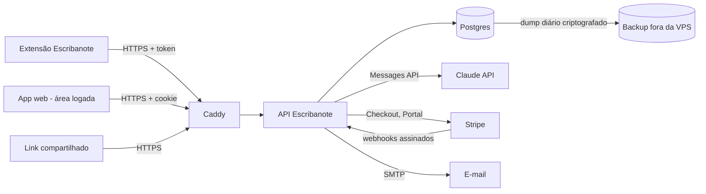
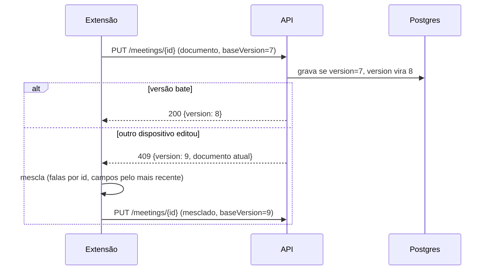

# TDD - Escribanote Pro (conta online, sincronização e IA inclusa)

| Campo           | Valor                                                                 |
| --------------- | --------------------------------------------------------------------- |
| Tech Lead       | Thiago M. Meneses                                                     |
| Product Manager | Thiago M. Meneses                                                     |
| Time            | Thiago M. Meneses (com apoio do Claude Code)                          |
| Epic/Ticket     | A criar                                                               |
| Figma/Design    | A criar (ver "Área logada: UX/UI")                                     |
| Status          | Em implementação: código pronto e publicado; falta ligar Stripe e IA e fazer o beta |
| Criado          | 2026-10-20                                                            |
| Última revisão  | 2026-10-20                                                            |

---

## Contexto

O **Escribanote** (chamado Escriba até a versão 2.3 e Reunilo nas 2.4 e 2.5) é uma extensão do Chrome que transcreve reuniões do Google Meet, Teams e Zoom e, desde a
versão 2.2, huddles do Slack e outros apps do computador (Whisper local). Ele foi construído como uma
alternativa melhor ao Tactiq. A versão 2.4.0 está publicada em escribanote.com. Ela é **100%
local**: as transcrições ficam no `chrome.storage` do navegador, com backup opcional numa pasta do
computador; os ajustes sincronizam pela conta do Chrome, e a IA usa a chave de API do próprio usuário.

Esse modelo agrada quem prioriza privacidade, mas deixa de fora quem quer acessar as reuniões de qualquer
lugar, compartilhar um link com a equipe ou usar IA sem criar uma conta na Anthropic e colar uma chave. É
exatamente o que o Tactiq vende: ele cobra US$ 12/mês (US$ 8/mês no plano anual) pelo Pro, com só 10
créditos de IA por mês, e US$ 0 no plano grátis, limitado a 10 transcrições e 5 créditos.

**Domínio**: produtividade em reuniões (transcrição, resumo, busca, compartilhamento), cobrança por
assinatura e IA generativa medida por uso.

**Stakeholders**: usuários atuais do Escribanote Free; profissionais e pequenos times no Brasil e fora
dele que hoje pagam ou cogitam pagar o Tactiq; o mantenedor, que precisa de receita que cubra IA,
servidor e taxas.

---

## Definição do Problema e Motivação

### Problemas que estamos resolvendo

- **As transcrições presas a um navegador**: hoje elas vivem num computador. Trocar de máquina, usar o
  celular ou reinstalar a extensão exige backup manual ou numa pasta.
  - Impacto: o usuário já perdeu reuniões ao remover a extensão (19/10/2026), e só recuperou porque
    havia uma cópia de diagnóstico.
- **IA exige chave de API**: para gerar ata, revisar ou perguntar, o usuário precisa criar uma conta na
  Anthropic, cadastrar cartão e colar uma chave.
  - Impacto: a maioria dos usuários não técnicos não usa a IA, que é o maior valor percebido do produto.
- **Sem compartilhamento**: não há link para mandar a ata ou a transcrição a quem não usa o Escribanote.
  - Impacto: o Tactiq ganha justamente no fluxo "terminei a reunião, mando o link para o time".
- **Sem receita**: a versão grátis não gera caixa para pagar servidor, domínio e evolução.

### Por que agora?

- A base técnica está madura: transcrição em três camadas, Whisper local, gravador do computador,
  backup, ID fixo da extensão (pré-requisito para login e mensagens entre o site e a extensão).
- O Tactiq cobra 3 a 4 vezes mais (US$ 8 a 12) e dá menos IA (10 créditos). Um plano de US$ 3 / R$ 15 com
  15 créditos de IA que acumulam é uma diferença fácil de comunicar.
- O formato JSON das reuniões (o mesmo do backup) já está estável, o que torna a sincronização direta.

### Impacto de não resolver

- **Negócio**: sem receita; o projeto depende de tempo voluntário.
- **Usuários**: perdas de dados continuam possíveis; a IA segue inacessível para a maioria.
- **Técnico**: cada pedido de "acessar de outro lugar" vira um remendo local (pastas, OneDrive).

---

## Escopo

### ✅ Dentro do escopo (V1)

- **Planos**: Escribanote Free (como hoje, sem conta) e **Escribanote Pro**. Mensal: **R$ 15** ou **US$ 3**, só
  cartão. Anual (2 meses grátis, preço promocional): **R$ 150** com **Pix Automático ou cartão**, ou
  **US$ 30** com cartão. Pix só no anual (decidido em 2026-10-20). Sem teste grátis.
- **Conta**: login com Google ou com link mágico por e-mail; uma conta por pessoa (sem times na V1).
- **Sincronização** da extensão com a nuvem: reuniões, notas, destaques, tags, títulos, nomes de
  participantes e ajustes. Envio automático ao fim de cada reunião e a cada poucos minutos durante a
  reunião; o histórico local existente é enviado na primeira vez, com confirmação.
- **Área logada** (app web em `app.escribanote.com`): biblioteca, página da reunião, busca em
  todas as transcrições, IA, compartilhamento, exportação, conta e cobrança (ver "Área logada: UX/UI").
- **IA inclusa**, sem chave: **15 créditos por ciclo**, que valem em qualquer ação de IA (ata, revisão,
  pergunta, e-mail de follow-up, lista de tarefas, perguntar a todas as reuniões). Créditos não usados
  acumulam até 30. Funciona na extensão e no app web; a chave própria continua aceita e não consome créditos.
- **Compartilhamento por link**: só leitura, com validade e revogação; o destinatário não precisa de conta.
- **Exportação e exclusão**: exportar tudo (o mesmo JSON do backup) e apagar a conta e os dados.
- **Privacidade**: criptografia em trânsito e no servidor; política de privacidade e termos atualizados.

### ❌ Fora do escopo (V1)

- Times, espaços compartilhados, papéis e SSO.
- Gravação ou armazenamento de **áudio** e vídeo (só texto).
- Upload de gravações para transcrever no servidor (o Whisper continua local).
- Integrações (Notion, Google Drive, Slack, HubSpot), workflows e MCP.
- App mobile nativo (o app web é responsivo).
- Criptografia ponta a ponta.
- Pacotes extras de IA avulsos.

### 🔮 Considerações futuras (V2+)

- Pacote extra de IA e modelos maiores sob demanda.
- Times com espaços compartilhados (o maior gatilho de upgrade do Tactiq).
- Integrações de exportação (Notion, Google Docs) e conector MCP.
- Criptografia ponta a ponta opcional por reunião.

---

## Solução Técnica

### Visão geral da arquitetura

Tudo roda na VPS atual (Hostinger KVM 1: 1 vCPU, 4 GB de RAM com ~1,9 GB livres, disco de 48 GB com
**74% em uso** em 20/10/2026; Ubuntu 24.04 com Docker e Caddy), ao lado do site e do formulário de contato. O site estático continua igual; entram três peças:
um **app web** estático (a área logada), uma **API** e um **Postgres**. A extensão continua funcionando
sem conta; com o Pro, ela sincroniza com a API.

**Componentes principais**:

- **Extensão (Escribanote 3.0)**: continua local-first. Ganha um "motor de sincronização" que envia
  mudanças à API, baixa reuniões de outros dispositivos e usa a IA da conta quando não há chave própria.
- **App web (área logada)**: SPA estática servida pelo Caddy; conversa só com a API.
- **API**: autenticação, reuniões, busca, compartilhamento, cotas de IA, cobrança e webhooks.
- **Postgres**: contas, reuniões, índice de busca, cotas e assinaturas.
- **Proxy de IA** (módulo da API): chama a API do Claude, aplica a cota e mede tokens e custo.
- **Stripe**: Checkout, Portal do cliente e webhooks.
- **E-mail transacional**: o SMTP da Hostinger, já em uso no formulário de contato, para links mágicos e
  avisos de cobrança.
- **Backups**: dump diário do banco, criptografado e copiado para fora da VPS.



### Fluxos de dados

**1. Assinar o Pro**
1. O usuário clica em "Assinar o Pro" (site, extensão ou app web) e entra com Google ou por e-mail.
2. A API cria a sessão de Checkout na Stripe com o preço da moeda certa (BRL ou USD). No Brasil, o
   usuário escolhe anual (**Pix Automático** ou **cartão**) ou mensal (**cartão**); em dólar, cartão. A
   Stripe aceita Pix em assinaturas recorrentes desde abril de 2026: o usuário autoriza o débito anual no
   app do banco uma vez.
3. A Stripe confirma o pagamento por webhook; a API marca a conta como Pro e abre o ciclo de cota de IA.
4. O app web mostra a confirmação e oferece "Conectar a extensão".

**2. Conectar a extensão à conta**
1. Na extensão, "Entrar na conta" abre o app web numa aba.
2. Com o login feito, o app web envia à extensão um token de dispositivo por mensagem direta entre o site
   e a extensão. Isso só é possível porque o ID da extensão agora é fixo (`ohbnmfogdcbgegnpcaphidkjinplednd`),
   e o manifest declara quais sites podem falar com ela.
3. A extensão guarda o token e mostra quantas reuniões locais existem; o usuário confirma o primeiro envio.

**3. Sincronizar uma reunião**
1. A extensão salva localmente como hoje (o local continua sendo a fonte durante a reunião).
2. A cada mudança relevante (a cada 2 minutos durante a reunião, e na hora ao terminar), ela envia o
   documento da reunião com a versão que conhece.
3. A API grava se a versão bater; senão responde "conflito" com a versão atual. A extensão mescla
   (falas são somadas por id; título, notas e nomes ficam com a edição mais recente) e reenvia.
4. Ao abrir, a extensão pede "o que mudou desde X" e baixa reuniões criadas ou editadas em outro lugar.



**4. Usar a IA inclusa**
1. Extensão ou app web pede `POST /api/v1/ai/{ação}` com o id da reunião (o app web) ou com a reunião
   inteira (a extensão, que tem a versão mais recente durante a reunião ao vivo).
2. A API reserva os créditos da ação de forma atômica; sem saldo, responde 402 com a data da renovação.
3. A API monta o prompt no servidor (o mesmo das versões locais) e chama o Claude em streaming.
4. Ao terminar, confirma o consumo e grava tokens e custo; se a chamada falhar, devolve o crédito.
5. O resultado é salvo na reunião (ata, correções ou resposta) e sincroniza com a extensão.

### APIs e endpoints

Todas as rotas ficam em `https://escribanote.com/api/v1/...` (mesmo endereço do site e do app,
sem CORS para o navegador; a extensão é liberada pelo ID fixo).

| Endpoint | Método | Descrição | Autenticação |
| --- | --- | --- | --- |
| `/api/v1/auth/email` | POST | Envia o link mágico de login (`{email}`); sempre 202, sem revelar se a conta existe | — |
| `/api/v1/auth/verify` | POST | Troca o token do link por uma sessão (`{token}`) | — |
| `/api/v1/auth/logout` | POST | Encerra a sessão atual | cookie |
| `/api/v1/devices` | POST / GET | Cria token de dispositivo para a extensão / lista dispositivos | cookie |
| `/api/v1/devices/{id}` | DELETE | Desconecta um dispositivo | cookie |
| `/api/v1/me` | GET | Conta, plano, créditos, fim do ciclo | cookie ou token |
| `/api/v1/me` | DELETE | Apaga conta e dados (LGPD), cancela a assinatura | cookie |
| `/api/v1/meetings` | GET | Lista; `changedSince` para sincronizar (inclui apagadas) | cookie ou token |
| `/api/v1/meetings/{id}` | GET / PUT / DELETE | Documento; grava com `baseVersion` (409 em conflito); lixeira de 30 dias | cookie ou token |
| `/api/v1/search` | GET | Busca em todas as falas, notas, atas e títulos, com trecho | cookie ou token |
| `/api/v1/ai/{summary,review,ask,ask_all,chapters}` | POST | IA inclusa; `summary` e `ask*` em streaming (SSE); `chapters` (1 crédito, esquema JSON, mínimo 3 min) devolve os capítulos validados e, com `meetingId`, salva na reunião | cookie ou token |
| `/api/v1/shares` | POST / GET | Cria / lista links de uma reunião | cookie |
| `/api/v1/shares/{id}` | DELETE | Revoga um link | cookie |
| `/s/{token}` | GET | Página pública só leitura (`noindex`) | — |
| `/api/v1/billing/checkout` | POST | Checkout da Stripe (`{currency: brl|usd}`) | cookie |
| `/api/v1/billing/portal` | POST | Portal do cliente (forma de pagamento, recibos, cancelar) | cookie |
| `/api/v1/billing/webhook` | POST | Eventos da Stripe, com assinatura verificada | assinatura Stripe |
| `/api/v1/export` | GET | Exporta tudo (mesmo JSON do backup local) | cookie |
| `/api/v1/health` | GET | Saúde (banco, versão) para o monitor | — |

**Exemplo: conta e créditos**

```json
// GET /api/v1/me
{
  "id": "0b8e…",
  "email": "pessoa@exemplo.com",
  "plan": "pro",
  "subscription": { "status": "active", "currency": "brl", "periodEnd": "2026-11-20T00:00:00Z", "cancelAtPeriodEnd": false },
  "credits": { "balance": 12, "perCycle": 15, "max": 30 }
}

// POST /api/v1/ai/ask sem saldo -> 402
{
  "error": "no_credits",
  "message": "Seus créditos de IA acabaram. Eles renovam em 20/11.",
  "renewsAt": "2026-11-20T00:00:00Z"
}
```

### Banco de dados

**Tabelas novas**:

- `users`: id, email (único), nome, idioma, país, criado/atualizado, apagado_em.
- `auth_identities`: user_id, provedor (google, email), sujeito do provedor.
- `auth_sessions`: sessões do app web (cookie) e tokens de dispositivo da extensão, com hash do token,
  nome do dispositivo, último uso e revogação.
- `meetings`: id (o mesmo id da extensão), user_id, título, plataforma, início, fim, `version`,
  atualizado_em, apagado_em (lixeira), `doc` criptografado (o JSON completo da reunião), tamanho.
  Índices: (user_id, início desc), (user_id, atualizado_em) para a sincronização.
- `meeting_search`: meeting_id, user_id e um índice de texto completo em português/inglês gerado das
  falas, títulos e notas. Índice GIN.
- `shares`: token (aleatório, 128 bits), meeting_id, criado_em, expira_em, revogado_em, acessos.
- `subscriptions`: user_id, cliente e assinatura na Stripe, status, preço, moeda, fim do ciclo,
  cancelamento agendado.
- `credit_balances` e `credit_ledger`: saldo por usuário e o histórico de cada concessão, uso e
  devolução (com chave única por fatura, para a concessão do ciclo nunca entrar duas vezes).
- `ai_requests`: user_id, meeting_id, tipo, modelo, tokens de entrada/saída/cache, custo estimado, status,
  duração. Base para o painel de custo e para detectar abuso.
- `stripe_events`: id do evento (único) e processado_em, para idempotência dos webhooks.

**Volume esperado**: uma reunião de 1 h tem cerca de 100 KB em JSON (medido na reunião de 17/10/2026,
com 252 falas). Mil assinantes com 20 reuniões/mês somam cerca de 2 GB/mês, o que cabe nos 50 GB da VPS
por bastante tempo. A partir de 60% do disco, os documentos migram para um armazenamento de objetos.

**Migração**: migrações versionadas e reversíveis; a primeira cria o esquema do zero (não há dados).

### Área logada: UX/UI (melhor que a do Tactiq)

Princípio: **ler, achar e reaproveitar reuniões rápido**. O Tactiq separa "My Meetings", espaços e
ferramentas de IA em telas diferentes, e esconde a IA atrás de créditos que acabam rápido. O Escribanote Pro
reúne tudo numa tela de três colunas, com teclado em primeiro lugar.

| Área | Tactiq (Pro) | Escribanote Pro |
| ---- | ------------ | ----------- |
| Biblioteca | Lista "Transcripts"/"My Meetings" | Lista por dia com prévia da ata, plataforma, duração e participantes; filtros (plataforma, com ata, com destaques, participante, período); visões salvas |
| Busca | Por espaço | Em **todas** as falas, notas e atas, com trecho destacado e salto direto ao momento da fala; atalho `/` |
| Página da reunião | Transcrição + ferramentas de IA | Transcrição agrupada por pessoa, com destaques e tags; **ata ao lado**, sempre visível; edição de nomes e do texto no lugar; linha do tempo de fala por pessoa |
| IA | 10 créditos/mês, que não acumulam | 15 créditos/mês que acumulam até 30, com contador visível; ações prontas (ata, revisão, follow-up, tarefas); perguntas sugeridas; respostas com links para as falas citadas; perguntas sobre todas as reuniões de uma vez |
| Análise de fala | "Sua parcela" | Parcela, ritmo, perguntas, interrupções e turnos por pessoa |
| Compartilhar | Link para quem tem conta Tactiq | Link público só leitura com validade e revogação, sem exigir conta; escolher incluir ou não a transcrição |
| Exportar | Docs/link | PDF, Markdown, TXT, SRT, VTT, JSON, cópia formatada para Docs/Notion |
| Navegação | Mouse | Paleta de comandos (`Ctrl+K`), atalhos `j/k` entre reuniões, tema claro e escuro |
| Celular | Limitado | Responsivo: biblioteca e ata em uma coluna |
| Privacidade | Dados na nuvem por padrão | Grátis continua 100% local; no Pro, o usuário vê o que foi enviado e pode apagar qualquer reunião da nuvem sem apagar a cópia local |

**Telas da V1**: Entrar; Biblioteca; Reunião (transcrição, ata, destaques, notas, análise, IA);
Busca; Compartilhamento público; Conta e plano (uso de IA, dispositivos conectados, cobrança, exportar,
apagar conta); Boas-vindas com "Conectar a extensão".

### Planos e cotas de IA

| | Grátis | Pro |
| --- | --- | --- |
| Preço | R$ 0 | R$ 15/mês (BRL) ou US$ 3/mês (USD) |
| Transcrição (Meet, Teams, Zoom, Slack/apps) | Ilimitada, local | Ilimitada, local + nuvem |
| Conta e app web | — | ✅ |
| Sincronização entre computadores | Backup em pasta (2.3) | ✅ automática |
| IA com chave própria | ✅ | ✅ (não consome a cota) |
| IA inclusa por ciclo | — | 15 créditos (acumulam até 30) |
| Links de compartilhamento | — | ✅ |

**Créditos**: um saldo único, mais fácil de entender e de vender do que cotas separadas, e mais
generoso que o Tactiq (10 créditos que não acumulam). Créditos não usados passam para o ciclo seguinte,
até um saldo máximo de 30. Uma chamada que falha não consome crédito.

| Ação de IA | Créditos |
| --- | --- |
| Ata/resumo da reunião | 1 |
| Revisão da transcrição com o glossário | 1 |
| Pergunta sobre uma reunião | 1 |
| E-mail de follow-up para os participantes | 1 |
| Lista de tarefas com responsáveis e prazos | 1 |
| Pergunta sobre todas as reuniões (ex.: "o que decidimos sobre o orçamento este mês?") | 2 |
| Reunião acima de 3 h (ata ou revisão) | +1 |

**Sem teste grátis**: a versão gratuita já funciona sem limite de tempo; o Pro começa pago, o que também
evita abuso da IA inclusa.

**Modelos de IA** (configuráveis no servidor):

| Ação | Modelo | Por quê |
| --- | --- | --- |
| Ata, revisão, pergunta sobre todas as reuniões | `claude-sonnet-5-5` (US$ 2 / US$ 10 por milhão de tokens) | Qualidade de texto e de correção |
| Pergunta, e-mail de follow-up, tarefas | `claude-haiku-5-5` (US$ 0,10 / US$ 0,50) | Respostas curtas; 20 vezes mais barato |

A transcrição vai no prompt de sistema com *prompt caching*: perguntas seguidas sobre a mesma reunião
leem do cache. A **revisão** custa 1 crédito por reunião a cada 24 h, porque a extensão revisa em lotes
durante a reunião; os lotes seguintes da mesma reunião nesse período não cobram de novo.

### Economia por assinante (estimativa)

Uma reunião de 1 h tem cerca de 15 mil tokens. Uso típico de 15 créditos em um mês (o acúmulo até 30 dobra o pior caso de um único mês, mas não a média):

| Ação (reunião de 1 h, ~16 mil tokens) | Modelo | Custo aproximado |
| --- | --- | --- |
| Ata | Sonnet 5.5 (16 mil entrada + 1,5 mil saída) | US$ 0,05 |
| Revisão | Sonnet 5.5 (16 mil + 3 mil) | US$ 0,06 |
| Pergunta / follow-up / tarefas | Haiku 5.5 (16 mil + 0,5 mil) | US$ 0,002 |
| Pergunta sobre todas as reuniões | Sonnet 5.5 (até ~60 mil + 1 mil) | US$ 0,13 |

Pior caso realista de um mês (30 créditos acumulados, todos em atas): ~US$ 1,50. Caso típico (5 atas,
5 revisões, 5 perguntas): ~US$ 0,56, ou ~19% de US$ 3.

| | R$ 15 (Brasil) | US$ 3 (exterior) |
| --- | --- | --- |
| Taxa Stripe (cartão, aprox.) | ~R$ 1,00 (≈ 6,6%); Pix costuma sair mais barato (conferir a tabela da Stripe) | ~US$ 0,40 (≈ 13%, mais se for cartão internacional) |
| IA (caso típico) | ~R$ 3 (≈ 20%) | ~US$ 0,56 (≈ 19%) |
| Servidor | VPS atual, custo marginal ~0 até alguns milhares de assinantes | idem |

A margem é boa no Brasil e apertada em dólar por causa da taxa fixa; o plano anual (V2) resolve isso. Um
limite global de gasto de IA por dia, com alerta, protege contra surpresas.

### Decisões de implementação (20/10/2026)

| Tema | Decisão |
| --- | --- |
| API | Node.js 24 + Fastify, em contêiner. Reaproveita as bibliotecas da extensão (`transcript`, `format`, `ai`, `stats`): a ata da conta sai igual à da chave própria |
| IA | SDK oficial `@anthropic-ai/sdk`, com chave própria do servidor e limite de gasto mensal no console da Anthropic |
| Banco | Postgres 17 em contêiner, só na rede interna do Docker. Busca com `tsvector` em português, sem acento |
| Documento da reunião | JSON comprimido (gzip, ~5x menor) e criptografado com AES-256-GCM antes de gravar |
| Login | Link mágico por e-mail (válido por 15 min, uso único). O token vai no fragmento da URL (`#`), que não aparece em logs. Google fica para depois |
| Sessão web | Cookie `HttpOnly`, `Secure`, `SameSite=Lax`, de 30 dias; escrita exige o cabeçalho `X-Escribanote` e a origem correta (CSRF) |
| Extensão | Token de dispositivo (`Authorization: Bearer`), só o hash no banco. CORS liberado apenas para `chrome-extension://ohbnmfogdcbgegnpcaphidkjinplednd`. A entrega do token usa `externally_connectable` |
| App web | Páginas estáticas em `/app`, com rotas pelo fragmento (`/app/#/r/{id}`); sem build, como a extensão |
| Rotas no Caddy | `/api/v1/*` e `/s/*` vão para a API; `/api/contato*` para o formulário; o resto é o site estático |
| Cobrança | Stripe Checkout em modo assinatura, 4 preços (`escribanote_pro_{brl,usd}_{monthly,yearly}`). Anual em BRL: cartão e Pix Automático (mandato `yearly` de até R$ 180, "Escribanote Pro anual" no app do banco). Mensal e USD: só cartão. Portal da Stripe para trocar a forma de pagamento e cancelar (troca mensal↔anual fica para depois do beta) |
| Créditos | Mensal: concedidos no `invoice.paid` de cada ciclo. Anual: a fatura concede o 1º lote e um laço de hora em hora (`grantMonthly`) concede os meses 2 a 12, uma vez por mês (chave `year:<assinatura>:<início>:<mês>`). Saldo = mín(saldo + 15, 30). Reserva atômica antes da chamada; devolução se falhar |
| Teto de gasto | Gasto de IA do dia somado no banco; acima do teto (padrão US$ 20/dia) a IA inclusa pausa e avisa |
| Backups | `pg_dump` diário, criptografado, guardado 14 dias na VPS; cópia para fora da VPS segue em aberto |
| Monitoramento | Uptime Kuma e Dozzle, que já rodam na VPS, mais `/api/v1/health` |

---

## Estado da implementação (20/10/2026)

| Parte | Estado | Onde |
| --- | --- | --- |
| API (contas, reuniões, busca, IA, créditos, Stripe mensal e anual, links, exclusão) | ✅ Pronta, 38 testes | `server/` |
| Área logada | ✅ Pronta, teste em Chrome real (26 verificações, inclui o site e a assinatura) | `site/app/` |
| Site com o Pro (home redesenhada, `/pro/`, menu "Pro" e "Entrar") | ✅ Publicado; spec em `docs/SPEC-site-e-assinatura.md` | `site/` |
| Extensão 2.5.0 (conectar, sincronizar, IA da conta) | ✅ Pronta, 33 testes unitários + 16 verificações ponta a ponta | `extension/` |
| Produção na VPS (banco, API, backups, app) | ✅ No ar em `escribanote.com/app` | `site/docker-compose.yml` |
| Extensão 2.5.0 no site | ✅ Publicada (zip + `latest.json`) | `site/download/` |
| Backup | ✅ Diário, criptografado; restauração testada | `server/README.md` |
| Política de privacidade com o Pro | ✅ Publicada (inclui a transferência internacional: VPS em Boston) | `site/privacidade.html` |
| Stripe (produto, preços, webhook, portal) | ⏳ Script pronto; falta a chave da conta | `server/scripts/stripe-setup.js` |
| Chave da Anthropic do servidor | ⏳ Falta criar | `pro.env` |
| Login com Google | 🔜 V1.1 | — |

### Checklist de lançamento

1. Colocar `STRIPE_SECRET_KEY` (teste) e `ANTHROPIC_API_KEY` no `pro.env` e rodar `stripe-setup.js` (ver `server/README.md`).
2. Testar uma assinatura de ponta a ponta no modo de teste da Stripe: Pix (e-mail `succeed_immediately@...`) e cartão `4242 4242 4242 4242`.
3. Cadastrar `/api/v1/health` no Uptime Kuma. (`DATA_KEY` e `BACKUP_PASSPHRASE` já têm cópia fora da VPS, desde 2026-10-20.)
4. Beta fechado com 10 a 20 pessoas (cupom de desconto pela Stripe), medindo custo de IA e erros por uma semana.
5. Trocar para as chaves `sk_live_...` e rodar `stripe-setup.js` de novo.
6. ~~Seção do Pro e preços no site, "Entrar" apontando para `/app`, extensão 2.5.0 no site~~ (feito em 2026-10-20).

---

## Riscos

| Risco | Impacto | Probabilidade | Mitigação |
| ----- | ------- | ------------- | --------- |
| Custo de IA acima do previsto (reuniões longas, uso máximo por todos) | Alto | Média | Créditos por tamanho da reunião, cache de prompt, modelo menor para perguntas, teto diário de gasto com alerta, painel de custo por usuário |
| Taxa fixa da Stripe come a margem em US$ 3 | Médio | Alta | Plano anual na V2; cobrar em BRL no Brasil (taxa menor); revisar o preço em USD após 3 meses de dados |
| Disco da VPS já 74% cheio (13 GB livres) | Médio | Alta | Documentos comprimidos (~20 KB por hora de reunião); limpar imagens Docker antigas antes do lançamento; alerta a 80% |
| VPS única: queda ou perda de disco | Alto | Média | Backup diário criptografado fora da VPS com teste mensal de restauração; a extensão é local-first e continua funcionando sem a API |
| Vazamento de dados (transcrições são sensíveis) | Alto | Baixa | Criptografia do documento no banco, TLS, tokens com hash, isolamento por usuário em toda consulta, revisão OWASP, logs sem conteúdo |
| Conflitos de sincronização causando perda de falas | Alto | Baixa | Versão otimista, mescla por id de fala, lixeira de 30 dias, a cópia local nunca é apagada pela sincronização |
| Abuso de link compartilhado ou de cota (contas falsas) | Médio | Média | Tokens longos com validade, limite de requisições por IP e por conta, Pro exige pagamento antes de liberar a IA |
| Mudança do protocolo do Meet/Teams | Médio | Média | Já mitigado: plano B lendo as legendas da tela e o Whisper local |
| Regras da Chrome Web Store (pagamento, privacidade, permissões) | Médio | Baixa | Pagamento fora da extensão (Stripe no site), divulgação clara do uso de dados, sem código remoto |
| Dados no exterior: a VPS fica em Boston (EUA, data center 24 da Hostinger) | Médio | Certa | Declarado na política de privacidade como transferência internacional para executar o contrato (LGPD, art. 33, IX); opção de migrar para o data center de Campinas se o público exigir dados no Brasil |
| LGPD e GDPR | Alto | Baixa | Política de privacidade e termos, consentimento no envio inicial, exportação e exclusão, DPA com a Anthropic (a API não treina com os dados) |
| Escopo crescer (times, integrações) | Médio | Alta | V1 fechada nesta lista; o resto vai para o backlog de V2 |

---

## Plano de Implementação

| Fase | Tarefa | Descrição | Responsável | Status | Estimativa |
| ---- | ------ | --------- | ----------- | ------ | ---------- |
| **1 - Base** | Infra | Postgres e API em Docker na VPS, subdomínio do app web, backups diários fora da VPS | Thiago | TODO | 2d |
| | Contas | Login com Google e por link mágico, sessões e tokens de dispositivo | Thiago | TODO | 3d |
| **2 - Sincronização** | API de reuniões | CRUD com versão, lixeira, `changedSince`, busca de texto completo | Thiago | TODO | 3d |
| | Extensão 3.0 | Conectar à conta, envio inicial com confirmação, motor de sincronização e mescla | Thiago | TODO | 4d |
| **3 - Cobrança** | Stripe | Produtos e preços BRL/USD, Checkout, Portal, webhooks idempotentes, estados da conta | Thiago | TODO | 3d |
| **4 - IA** | Proxy e cotas | Endpoints de ata, revisão e pergunta em streaming; cota atômica; custo por chamada; teto diário | Thiago | TODO | 3d |
| **5 - App web** | Biblioteca e reunião | Lista, filtros, página da reunião com ata ao lado, edição, análise | Thiago | TODO | 6d |
| | Busca, compartilhar, conta | Busca global, links públicos, conta, uso de IA, dispositivos, exportar e apagar | Thiago | TODO | 4d |
| **6 - Qualidade** | Testes | Unitários, integração da API, ponta a ponta (extensão + app + Stripe em modo de teste) | Thiago | TODO | 4d |
| | Segurança e LGPD | Revisão OWASP, política de privacidade e termos, página de status | Thiago | TODO | 2d |
| **7 - Lançamento** | Beta fechado | 10 a 20 usuários com cupom, medir custo de IA e erros | Thiago | TODO | 7d (corrido) |
| | Lançamento | Abrir o Pro no site e na extensão | Thiago | TODO | 1d |

**Total estimado**: cerca de 37 dias de trabalho mais 1 semana de beta (8 a 9 semanas para uma pessoa).

**Dependências**: a Fase 2 depende da 1; a 4 depende da 3 (só assinante usa a IA inclusa); o beta exige
segurança e LGPD concluídas.

---

## Considerações de Segurança

### Autenticação e autorização

- **App web**: sessão em cookie `HttpOnly`, `Secure`, `SameSite=Lax`, com renovação e expiração; proteção
  contra CSRF nas rotas que alteram dados.
- **Extensão**: token de dispositivo longo e revogável, guardado só no `chrome.storage.local`; o servidor
  guarda apenas o hash. A tela de conta lista os dispositivos e permite revogar.
- **Login**: Google (token de identidade verificado no servidor) ou link mágico de uso único, válido por
  15 minutos.
- **Autorização**: toda consulta é filtrada pelo usuário da sessão; nenhuma rota aceita `userId` do
  cliente. Links públicos dão acesso só leitura àquela reunião.

### Proteção de dados

- **Em trânsito**: TLS em tudo (Caddy, certificados automáticos), HSTS.
- **Em repouso**: o documento de cada reunião é criptografado pela API (AES-256-GCM) com uma chave mestra
  guardada fora do banco e do repositório; os dumps de backup também são criptografados.
- **Índice de busca**: guarda termos normalizados das falas para a busca funcionar. É um risco aceito
  (sem ele, não há busca no servidor), documentado na política de privacidade.
- **Dados pessoais coletados**: e-mail, nome, país, conteúdo das reuniões (falas, nomes de participantes,
  notas), dados de cobrança (ficam na Stripe; o Escribanote guarda só os identificadores).
- **Base legal (LGPD)**: execução de contrato (assinatura) e consentimento explícito no primeiro envio
  das reuniões locais.
- **Retenção**: lixeira de 30 dias; conta cancelada fica com os dados por 90 dias (só leitura e
  exportação), depois são apagados; a exclusão da conta apaga tudo em até 30 dias, inclusive dos backups.
- **Avisos aos participantes**: a mensagem de aviso da extensão passa a mencionar que a transcrição é
  guardada na conta do usuário.

### Conformidade

| Regulação | Requisito | Implementação |
| --------- | --------- | ------------- |
| **LGPD** | Transparência, acesso, exclusão | Política de privacidade, exportar tudo, apagar conta |
| **GDPR** | Mesmos direitos para usuários na Europa | Mesmas funções; lista de subprocessadores (Stripe, Anthropic, Hostinger) |
| **PCI DSS** | Não guardar dados de cartão | Checkout hospedado pela Stripe (SAQ A) |

### Boas práticas

- Validação de entrada em todos os endpoints; consultas parametrizadas.
- CSP estrita no app web; transcrições renderizadas sempre como texto (nunca como HTML).
- Limite de requisições: login (5 por 15 min por IP/e-mail), IA (10 por minuto por conta), links públicos
  (60 por minuto por IP).
- Webhooks da Stripe com verificação de assinatura e tabela de eventos para idempotência.
- Logs de auditoria: login, novo dispositivo, compartilhamento, exportação, exclusão.

### Segredos

- Chaves da Stripe e da Anthropic, chave mestra de criptografia e credenciais do banco ficam num arquivo
  de ambiente com permissão restrita na VPS (como o `contato.env` atual), nunca no repositório nem no app web.
- Rotação: chave da Anthropic e da Stripe a cada 90 dias ou em suspeita; a chave mestra tem versão, o
  que permite rotação sem reescrever tudo de uma vez.

---

## Estratégia de Testes

| Tipo | Escopo | Meta | Abordagem |
| ---- | ------ | ---- | --------- |
| **Unitários** | Mescla de sincronização, cotas, cálculo de créditos, criptografia | > 80% nos módulos críticos | Testes de unidade, como os 29 atuais da extensão |
| **Integração** | Endpoints + Postgres real | Caminhos críticos | Banco de teste descartável por execução |
| **Ponta a ponta** | Extensão + app web + API | Fluxos principais | Chrome real, como os testes atuais (`e2e-*`) |
| **Cobrança** | Checkout, renovação, falha de pagamento, cancelamento | Todos os eventos usados | Stripe em modo de teste e simulação de eventos |
| **Carga** | Sincronização e busca | 50 req/s sustentados | Script de carga contra a VPS de teste |

**Cenários essenciais**:
- ✅ Reunião gravada offline sincroniza quando a conexão volta, sem duplicar falas.
- ✅ Duas edições do título em computadores diferentes: vence a mais recente, nenhuma fala se perde.
- ✅ Usuário A não acessa reunião, busca, link ou cota do usuário B (403/404).
- ✅ Cota esgotada responde 402 e não chama a API do Claude; falha da IA devolve o crédito.
- ✅ Webhook repetido não muda o estado duas vezes; assinatura inválida é rejeitada.
- ✅ Link revogado ou vencido para de funcionar na hora.
- ✅ Assinatura cancelada mantém leitura e exportação e bloqueia a IA inclusa.
- ✅ A extensão continua 100% funcional com a API fora do ar.

---

## Monitoramento e Observabilidade

### Métricas

| Métrica | Tipo | Alerta | Onde |
| ------- | ---- | ------ | ---- |
| Latência da API (p95) | Latência | > 800 ms por 5 min | Painel da API |
| Taxa de erro 5xx | Erros | > 2% por 5 min | Painel + e-mail |
| Disponibilidade externa | Uptime | 2 falhas seguidas | Monitor externo (ping a cada minuto) |
| Gasto de IA no dia | Custo | > 80% do teto diário | E-mail |
| Erros da API do Claude | Erros | > 5 em 5 min | E-mail |
| Webhooks da Stripe com falha | Contador | > 3 em 1 h | E-mail |
| Backup diário | Sucesso | falhou ou não rodou | E-mail |
| Disco da VPS | Uso | > 75% | E-mail |
| Conflitos de sincronização | Contador | pico anormal | Painel |

### Logs estruturados

Logs em JSON por requisição: rota, status, duração, id do usuário (pseudônimo), id da requisição.
Chamadas de IA registram modelo, tokens e custo. **Nunca** entram no log: conteúdo de reuniões, e-mails
completos, tokens, chaves ou dados de cartão.

### Painéis

- **Operação**: requisições, erros, latência, IA (chamadas, falhas, custo), fila de e-mails.
- **Negócio**: assinantes ativos por moeda, novas assinaturas, cancelamentos, receita do mês, custo de IA
  por assinante, uso médio da cota por tipo.

---

## Plano de Rollback

### Estratégia de deploy

- Cada versão da API e do app web é uma imagem com tag; o Caddy aponta para a versão ativa.
- A extensão consulta uma configuração remota (`pro_enabled`, `sync_enabled`, `ai_enabled`), que liga e
  desliga cada recurso sem publicar uma versão nova.
- Lançamento em etapas: beta com cupom, depois aberto a todos.

### Gatilhos

| Gatilho | Ação |
| ------- | ---- |
| Erros 5xx > 5% por 5 min | Voltar para a imagem anterior |
| Suspeita de perda ou mistura de dados entre contas | Desligar a sincronização na hora (`sync_enabled=false`), investigar, comunicar |
| Gasto de IA acima do teto | Desligar a IA inclusa (`ai_enabled=false`); a chave própria continua |
| Webhooks da Stripe falhando | Pausar novas assinaturas; reprocessar eventos depois |
| Migração do banco falhou | Parar; restaurar o snapshot tirado antes da migração |

### Passos

1. Desligar o recurso afetado pela configuração remota (efeito em minutos).
2. Voltar a imagem anterior da API ou do app web.
3. Se houve migração: aplicar a migração reversa ou restaurar o snapshot.
4. Conferir integridade (contagem de reuniões por usuário, eventos da Stripe processados).
5. Avisar os assinantes afetados por e-mail se houve impacto visível; análise da causa em 24 h.

A extensão é local-first: nenhum rollback do servidor apaga dados do computador do usuário.

---

## Métricas de Sucesso

| Métrica | Meta (3 meses após o lançamento) |
| ------- | -------------------------------- |
| Conversão de usuários ativos do grátis para o Pro | 3% a 5% |
| Cancelamento mensal | < 6% |
| Custo de IA por assinante | < 30% da receita líquida |
| Reuniões sincronizadas sem erro | > 99,5% |
| Latência p95 da API | < 500 ms |
| Incidentes de dados entre contas | 0 |

---

## Alternativas Consideradas

| Opção | Prós | Contras | Decisão |
| ----- | ---- | ------- | ------- |
| **VPS própria + Postgres** | Custo marginal zero, controle total, mesma infra do site | Backups e atualizações por nossa conta; ponto único de falha | ✅ Escolhida |
| Supabase | Login, banco e storage gerenciados | US$ 25/mês após o plano grátis; mais dependência | Fica como saída se a VPS virar gargalo |
| Firebase (como o Tactiq) | Escala e tempo real prontos | Preso ao Google, custo por leitura imprevisível | Não |
| **Stripe** | Cartão mundial, BRL e USD, Portal pronto, assinaturas maduras | Taxa fixa pesa em US$ 3 | ✅ Escolhida |
| Mercado Pago / Asaas | Pix e boleto baratos no Brasil | Fracos para cobrar em dólar fora do Brasil | Não: a Stripe já cobre Pix Automático e cartão |
| **Criptografia no servidor** | Busca, links e IA no servidor | Servidor consegue ler os dados | ✅ Escolhida |
| Ponta a ponta | Privacidade máxima | Sem busca nem link público; IA precisa receber o texto | V2 opcional |

---

## Dependências

| Dependência | Tipo | Status | Risco |
| ----------- | ---- | ------ | ----- |
| VPS Hostinger (Docker, Caddy) | Infra | Pronta | Médio (ponto único) |
| Stripe (conta BR, preços BRL/USD) | Externa | A criar | Baixo |
| API do Claude (Anthropic) | Externa | Chave existente; criar chave de produção separada | Baixo |
| Login com Google (OAuth) | Externa | A configurar | Baixo |
| SMTP Hostinger | Externa | Pronto (formulário de contato) | Baixo |
| Armazenamento de backup fora da VPS | Infra | A escolher | Médio |
| ID fixo da extensão | Interna | Pronto (2.3.0) | — |

---

## Questões em Aberto

| # | Questão | Contexto | Responsável | Status |
| - | ------- | -------- | ----------- | ------ |
| 1 | Créditos separados ou saldo único? | Saldo único de 15, acumulando até 30 | Thiago | ✅ Decidido em 2026-10-20 |
| 2 | Qual modelo Claude para cada tarefa? | Medir qualidade e custo com reuniões reais no beta | Thiago | 🔴 Aberta |
| 3 | Aceitar Pix já na V1? | Pix Automático + cartão pela Stripe | Thiago | ✅ Decidido em 2026-10-20 |
| 4 | Teste grátis do Pro? | Não: o Free já é ilimitado no tempo | Thiago | ✅ Decidido em 2026-10-20 |
| 5 | Onde guardar os backups fora da VPS? | Opções: armazenamento de objetos barato ou o backup da própria Hostinger | Thiago | 🔴 Aberta |
| 6 | Conta grátis com app web só leitura? | Pode atrair usuários, mas aumenta o custo de servidor | Thiago | 🔴 Aberta |
| 7 | Nome comercial | **Escribanote** (Escriba é muito usado; Reunilo foi trocado em 2026-10-20); escribanote.com e .com.br estavam livres. Falta checar o INPI | Thiago | ✅ Decidido em 2026-10-20 |

---

## Roadmap

| Fase | Entregas | Duração | Status |
| ---- | -------- | ------- | ------ |
| 0 - Decisões | Registrar escribanote.com e .com.br, conta na Stripe, Google OAuth | 3 dias | ⏳ |
| 1 - Base | Infra, contas | 1 semana | ⏳ |
| 2 - Sincronização | API de reuniões, extensão 3.0 | 1,5 semana | ⏳ |
| 3 - Cobrança e IA | Stripe, proxy de IA, cotas | 1,5 semana | ⏳ |
| 4 - App web | Biblioteca, reunião, busca, compartilhar, conta | 2 semanas | ⏳ |
| 5 - Qualidade | Testes, segurança, LGPD | 1 semana | ⏳ |
| 6 - Beta e lançamento | Beta fechado, ajustes, abertura | 1,5 semana | ⏳ |

**Marcos**: M1 sincronização funcionando com a extensão; M2 primeira assinatura paga em modo de teste;
M3 beta fechado; M4 lançamento público.

---

## Referências

- Preços e créditos do Tactiq: [tactiq.io/pricing](https://tactiq.io/pricing) e
  [entendendo os planos](https://help.tactiq.io/en/articles/8649126-understanding-tactiq-plans-and-pricing)
- Compartilhamento e espaços no Tactiq: [compartilhar com o time](https://help.tactiq.io/en/articles/9188113-how-to-share-a-transcript-with-your-team),
  [Team Spaces](https://tactiq.io/team-spaces),
  [compartilhamento automático](https://help.tactiq.io/en/articles/11400294-how-to-automatically-share-meeting-transcripts-to-a-space-team-plan-only)
- Upload de gravações no Tactiq: [upload de transcrição ou gravação](https://help.tactiq.io/en/articles/7944393-upload-transcript-or-recording-to-tactiq)
- Avaliações: [G2, Tactiq vs tl;dv](https://www.g2.com/compare/tactiq-vs-tl-dv)
